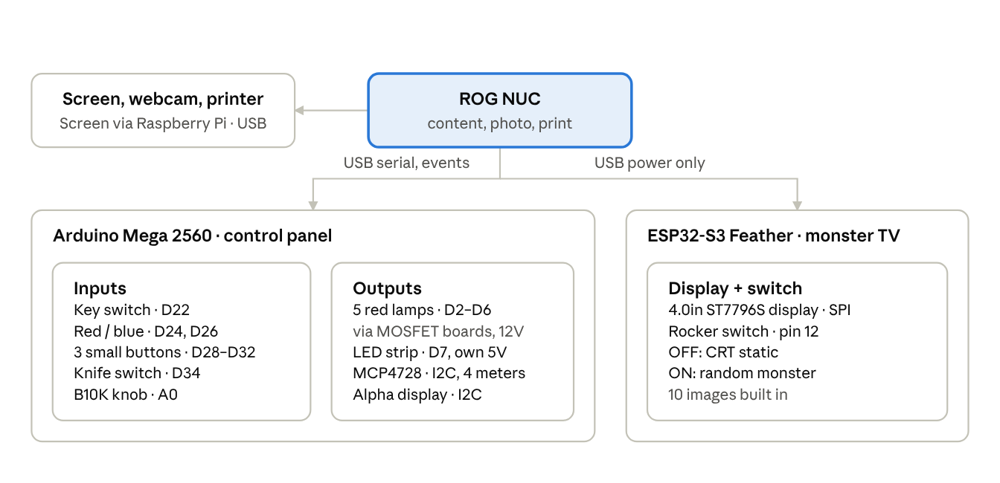
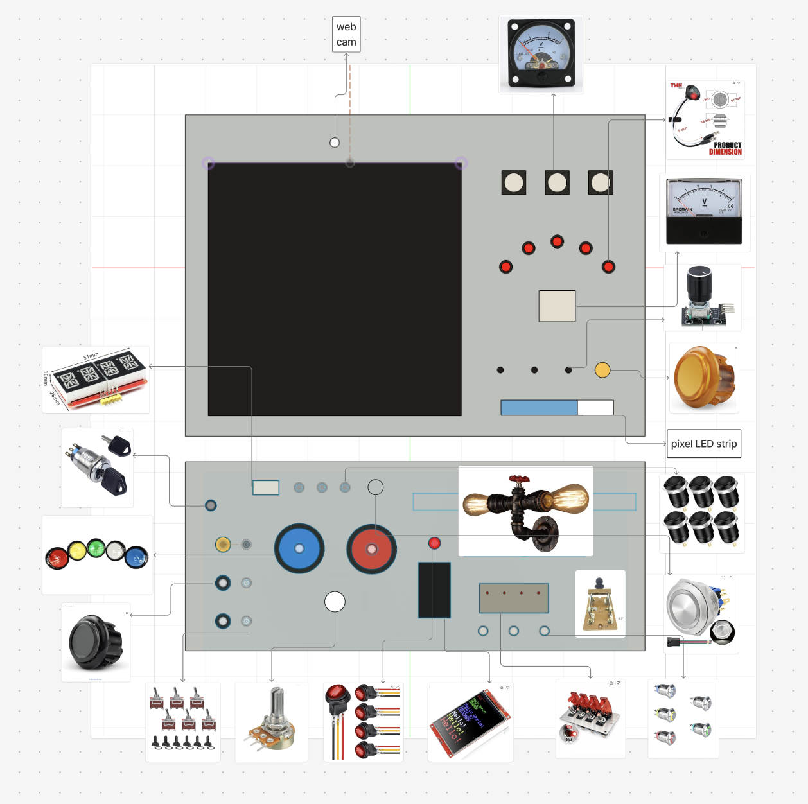

# Halloween Machine — Hardware Documentation

## Overview

Visitor flow on the control panel:

1. Turn the key switch (either direction) — a new session starts and the NUC takes the photo.
2. Turn the B10K knob to pick one of 5 characters — one red lamp and the big meter follow.
3. Press the red or blue arcade button to pick the story mode — the knife switch unlocks.
4. Pull the knife switch (either direction) — the NUC starts generating the 4-panel comic.
5. Wait — the blue LED strip fills as a progress bar.
6. The comic prints; the machine returns to idle.

At any time: the 3 small black buttons make the 3 small meters swing wildly, and the alphanumeric display flashes OPEN, BOO! and garbled characters. The monster TV runs on its own: rocker switch OFF shows CRT static, ON shows a random monster.

### Panel layout

## Bill of materials

22 line items across the NUC, the Mega control panel and the ESP32 monster TV.

| # | Part | Model / spec | Qty | Connects to | Role |
| --- | --- | --- | --- | --- | --- |
| 1 | Mini PC | ROG NUC | 1 | — | Main controller |
| 2 | Main screen | Pixel screen | 1 | Raspberry Pi  | Interactive story content |
| 3 | Webcam | USB webcam | 1 | NUC USB | Takes the visitor photo when the key turns |
| 4 | Printer | USB printer | 1 | NUC USB | Prints the 4-panel comic |
| 5 | Microcontroller | Arduino Mega 2560 | 1 | NUC USB | Runs the whole control panel |
| 6 | Key switch | DMWD 19mm, 2-position latching, 1NO 1NC, 3 pins | 1 | Mega D22 | Starts a session (any turn counts) |
| 7 | Arcade buttons | Red + blue, momentary, no light | 2 | Mega D24, D26 | Pick story mode |
| 8 | Small push buttons | STARELO 12mm, momentary NO, pre-wired, no LED | 3 | Mega D28, D30, D32 | Make the small meters swing |
| 9 | Potentiometer | B10K, 3 signal pins + 2 unused pins | 1 | Mega A0 | Pick 1 of 5 characters |
| 10 | Knife switch | YXQ HD11-200/28 DPST, screw terminals | 1 | Mega D34 | Trigger comic generation (any pull counts) |
| 11 | Character lamps | TMH 3/4" red marker light, 12V DC, 2 wires | 5 | MOSFET boards | One lit per character position |
| 12 | MOSFET driver | GODIYMODULES F5305S, 4-channel, optocoupled | 2 | Mega D2–D6 + 12V | Switch the 12V lamps |
| 13 | DAC | MCP4728, 4-channel, I2C 0x60 | 1 | Mega D20/D21 | Drives all 4 meters |
| 14 | Main meter | BAOMAIN DH-670, DC 0–5V | 1 | MCP4728 VA | Needle points to the character (1–5V) |
| 15 | Small meters | Boxonly SO-45, DC 0–3V, round | 3 | MCP4728 VB/VC/VD | Decorative wild swinging |
| 16 | Alphanumeric display | EC Buying 0.54" HT16K33 14-segment, 4 digits, I2C 0x70 (2-pack, 1 used) | 1 | Mega D20/D21 | Shows randomized texts |
| 17 | LED strip | Environmental Lights RGB-pixelcontrol-144-12-1.2m, WS2813, 5V, BRG order, 32 LEDs | 1 | Mega D7 + 5V supply | Progress bar |
| 18 | Microcontroller | Adafruit Feather ESP32-S3 | 1 | NUC USB (power only) | Runs the monster TV |
| 19 | TFT display | Hosyond 4.0" 480×320 ST7796S SPI (MSP4022), touch unused | 1 | ESP32 SPI | CRT static / monster images |
| 20 | Rocker switch | Round, red-lit, 3 spade pins, 12V rated | 1 | ESP32 pin 12 | Static (OFF) or monster (ON) |
| 21 | Power supply | 12V DC adapter, ≥ 1A | 1 | MOSFET boards DC+/DC− | Powers the 5 lamps |
| 22 | Power supply | 5V DC adapter, 3A, 5.5×2.1mm barrel | 1 | LED strip DC jack | Powers the LED strip |

## Power

Four power sources, kept separate; only the LED strip's ground is shared with the Mega.

| Source | Feeds | Ground rule |
| --- | --- | --- |
| NUC USB → Mega | Mega, MCP4728, alphanumeric display, potentiometer (all from Mega 5V) | — |
| NUC USB → ESP32 | ESP32, TFT display (VCC on Feather USB pin, backlight on 3V) | — |
| 5V 3A adapter | LED strip, via the strip's own DC jack | Strip GND connects to Mega GND |
| 12V ≥ 1A adapter | Both MOSFET boards (DC+/DC−) → 5 lamps | No connection to Mega GND (boards are optocoupled) |

## Arduino Mega wiring

### Inputs

| Part | Wire / terminal | Mega |
| --- | --- | --- |
| Key switch | COM | GND |
| Key switch | NO | D22 |
| Key switch | NC | not connected |
| Red arcade button | either terminal / other | D24 / GND |
| Blue arcade button | either terminal / other | D26 / GND |
| Small black button 1 / 2 / 3 | red / black (no polarity) | D28 / D30 / D32, other to GND |
| Knife switch (one pole only) | hinge post | GND |
| Knife switch (one pole only) | clip post | D34 |
| B10K pot | left pin | GND |
| B10K pot | middle pin | A0 |
| B10K pot | right pin | 5V |
| B10K pot | 2 lower pins (mounting/switch) | not connected |

### I2C bus (shared, wired in parallel)

| Module pin | Mega |
| --- | --- |
| MCP4728 VCC | 5V |
| MCP4728 GND | GND |
| MCP4728 SDA | D20 |
| MCP4728 SCL | D21 |
| MCP4728 LDAC | GND |
| MCP4728 RDY | not connected |
| Alphanumeric display VCC | 5V |
| Alphanumeric display Vi2c | 5V  |
| Alphanumeric display GND | GND |
| Alphanumeric display SDA | D20 |
| Alphanumeric display SCL | D21 |

### Meters (on the MCP4728)

| MCP4728 output | Meter | Meter + | Meter − | Triggered by |
| --- | --- | --- | --- | --- |
| VA | Main DH-670 (0–5V) | VA | GND | Knob position |
| VB | Small SO-45 #1 (0–3V) | VB | GND | Small button 1 (D28) |
| VC | Small SO-45 #2 | VC | GND | Small button 2 (D30) |
| VD | Small SO-45 #3 | VD | GND | Small button 3 (D32) |

### Character lamps (12V via MOSFET boards)

Board 1 channel 3 is broken, so lamp 3 runs on board 2 channel 2.

| Lamp (knob position) | Mega signal | Board · channel | Input pair | Lamp red → / black → |
| --- | --- | --- | --- | --- |
| Lamp 1 (far left) | D2 | Board 1 · ch1 | PWM1 + GND1 | OUT1+ / OUT1− |
| Lamp 2 | D3 | Board 1 · ch2 | PWM2 + GND2 | OUT2+ / OUT2− |
| Lamp 3 | D4 | Board 2 · ch2 | PWM2 + GND2 | OUT2+ / OUT2− |
| Lamp 4 | D5 | Board 1 · ch4 | PWM4 + GND4 | OUT4+ / OUT4− |
| Lamp 5 (far right) | D6 | Board 2 · ch1 | PWM1 + GND1 | OUT1+ / OUT1− |

Every GNDx of a used channel goes to Mega GND (they can be daisy-chained). Both boards get 12V on DC+/DC−.

### LED strip (input end only)

The wires must go on the end the arrows point **away** from. The factory plug and DC jack sit on the output end; the DC jack stays there for power.

| Strip wire | Pad label | Connect to |
| --- | --- | --- |
| Black | +5V | not connected (insulate) |
| Blue | − | Mega GND |
| Red | DIN | Mega D7 |
| Green | IN (backup data) | Mega GND |

## ESP32-S3 wiring

The display needs 8 wires and the rocker switch 2; the 10 monster images are compiled into the program, so the SD card pins stay empty.

### TFT display (long pin row)

| Display pin | Feather pin |
| --- | --- |
| VCC | USB (5V) |
| GND | GND |
| CS | 10 |
| RESET | 6 |
| DC/RS | 9 |
| SDI (MOSI) | MO (GPIO35) |
| SCK | SCK (GPIO36) |
| LED (backlight) | 3V |
| SDO (MISO) | not connected |
| T\_CLK, T\_CS, T\_DIN, T\_DO, T\_IRQ | not connected |

### Rocker switch

| Terminal | Feather |
| --- | --- |
| The 2 terminals that connect when ON | GND and pin 12 (either way) |

## Fake buttons (not wired yet, can be used later)

These are mounted on the panel as decoration and are not connected to the Mega; only the first one, the switch panel, gets a 12V 1A adapter so its switch lights come on.

| # | Part | Model / spec | Wiring |
| --- | --- | --- | --- |
| 1 | Toggle switch panel with safety covers | MGI SpeedWare 4-way LED toggle panel, 12V DC, stainless steel, red covers | 12V 1A adapter |
| 2 | Rotary encoder | QSYZAIL KY-040, push switch and knob cap, 5V, 20 steps/turn | Not wired |
| 3 | 30mm big-head button | ZJWZJH 30mm momentary metal button, 12V LED ring, IP67, with plug | Not wired |
| 4 | Momentary toggle switch | RVBOATPAT KN3C-123, (ON)-OFF-(ON) spring-return, SPDT, 12V, waterproof boot | Not wired |
| 5 | 12mm halo button | DMWD 12mm metal momentary button, LED halo ring, 12–24V, 4 pins 1NO, 5 mixed colours | Not wired |
| 6 | 30mm arcade button | Qanba Gravity KS silent mechanical, 30mm snap-in, clear black D04 | Not wired |

## 3D models

Files in [`models/`](models/). The `.f3d` files are the Fusion 360 source (File → Open → Open from my computer); the `-preview.stl` files can be viewed in 3D directly on GitHub.

| Part | Fusion 360 source | Preview (STL) |
| --- | --- | --- |
| Lightbox | [`lightbox.f3d`](models/lightbox.f3d) (161 KB) | [`lightbox-preview.stl`](models/lightbox-preview.stl) (32 KB) |
| Scooby panel | [`scooby-panel.f3d`](models/scooby-panel.f3d) (2.0 MB) | [`scooby-panel-preview.stl`](models/scooby-panel-preview.stl) (208 KB) |
